  
  

  
  

  

## About me

Technology and business management enthusiast exploring software development, SaaS, artificial intelligence and process automation. My goal is to turn real-world challenges into useful, efficient and intuitive digital solutions.

## Areas of focus

| Software development | Artificial intelligence |
| :--- | :--- |
| Web applications and SaaS solutions for real-world needs. | Exploring AI tools to improve processes and products. |
| **Process automation** | **Business management** |
| Simplifying tasks and digital workflows. | Systems that support organization and decision-making. |

## Technologies I'm exploring

<strong>Front-end</strong> 

  
<strong>Back-end & database</strong> 

  
<strong>Tools</strong> 

  
<strong>Electronics & embedded systems</strong> 

## Featured project

<table>
<tr>
<td colspan="3">

**Gestão MEI** &nbsp; · &nbsp; In development

A digital solution designed to simplify management for microentrepreneurs.

</td>
</tr>
<tr>
<td align="center" width="33%">

**Scheduling**

Appointment management

</td>
<td align="center" width="33%">

**Inventory**

Product tracking

</td>
<td align="center" width="33%">

**Pricing**

Price calculation

</td>
</tr>
</table>

Private repository

## GitHub statistics

Public activity and contribution history. Language statistics will be relevant once public code is available.

  
  

## Contributions

<!-- The first successful GitHub Actions run publishes these images to the output branch. -->

## Connect with me

Let's connect and exchange ideas about technology, innovation and digital projects.

  
  

---

  <strong>Build. Learn. Innovate.</strong> 
  Turning ideas into digital solutions.  
  <a href="https://github.com/ErivanJr-3">GitHub · @ErivanJr-3</a>

