  
  

  
  

## ✦ Sobre mim

Entusiasta de tecnologia e gestão empresarial, explorando o desenvolvimento de sistemas, SaaS, inteligência artificial e automação de processos. Meu objetivo é transformar desafios reais em soluções digitais úteis, eficientes e intuitivas.

## 🚀 Áreas de foco

| Desenvolvimento de sistemas | Inteligência artificial |
| :--- | :--- |
| Aplicações web e soluções SaaS para necessidades reais. | Exploração de ferramentas de IA para melhorar processos e produtos. |
| **Automação de processos** | **Gestão empresarial** |
| Simplificação de tarefas e rotinas digitais. | Sistemas de apoio à organização e à tomada de decisões. |

## 🛠️ Tecnologias em exploração

<strong>Front-end</strong> 

  
<strong>Back-end e banco de dados</strong> 

  
<strong>Ferramentas</strong> 

## 📌 Projeto em destaque

<table>
<tr>
<td colspan="3">

**Gestão MEI** &nbsp; · &nbsp; 🔒 Em desenvolvimento

Uma solução digital para simplificar a gestão de microempreendedores.

</td>
</tr>
<tr>
<td align="center" width="33%">

📅 **Agenda**

Organização de atendimentos

</td>
<td align="center" width="33%">

📦 **Estoque**

Controle de produtos

</td>
<td align="center" width="33%">

💲 **Precificação**

Cálculo de preços

</td>
</tr>
</table>

🔒 Repositório privado

## 📊 Estatísticas do GitHub

  
  

## 📈 Atividade recente

## 🐍 Contribuições

<!-- The first successful GitHub Actions run publishes these images to the output branch. -->

---

  <strong>Construir. Aprender. Inovar.</strong> 
  Transformando ideias em soluções digitais.  
  <a href="https://github.com/ErivanJr-3">GitHub · @ErivanJr-3</a>

